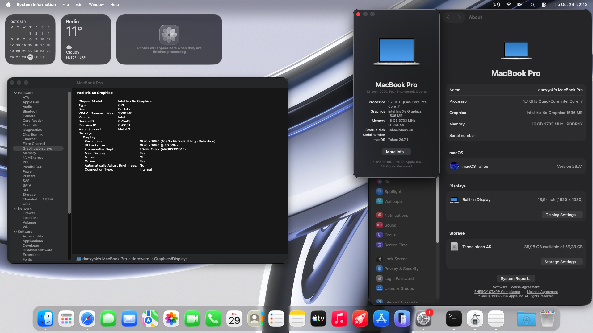

# Dell Latitude 7420 — macOS Tahoe EFI

OpenCore EFI for a Dell Latitude 7420 with an 11th gen Intel Core i7-1165G7 and Iris Xe, running macOS Tahoe 26.7.1 (25G241).

## Reported working

- Intel Iris Xe with full graphical acceleration (Metal 2)
- Internal 1920×1080 display and brightness control
- Audio, Wi-Fi through AirportItlwm kext, and Bluetooth
- Trackpad
- Safari video playback

## Known issues and untested areas

No currently failing feature has been reported. Sleep/wake, external displays, FileVault, clean-install media, and macOS upgrade paths are not tested. Please note that this repository state is still "WIP"!!

## Config profiles

- `EFI/OC/config.plist` is the normal macOS boot profile.
- `EFI/OC/config-recovery.plist` is for macOS Recovery. OpenCore always reads `config.plist`; copy the Recovery profile over it on the EFI partition, boot Recovery, then restore the normal profile.

## Prepare a local EFI

The checked-in configs have blank SMBIOS fields. The vendored [GenSMBIOS](https://github.com/corpnewt/GenSMBIOS) utility downloads Acidanthera's `macserial`, then generates serial/MLB, UUID, and ROM locally; Its MIT license is retained in `tools/GenSMBIOS/`. Never reuse or publish generated identities; keep `build/EFI` folder private!

To build EFI on Windows, clone this repository and run `tools/prepare-efi.bat`,
choose 3rd option(Generate SMBIOS), then type `MacBookPro16,2`, record Serial, Board Serial, SmUUID, and ROM, and then quit(Q). Do not select a plist there; paste the recorded values at the batch prompts. The helper creates `build\EFI\` folder without editing checked-in templates, downloads both firmware drivers, verifies pinned SHA-256 hashes, fills both profiles, and enables the drivers in the prepared copy. Templates keep missing external drivers disabled because `HaltLevel` is `DEBUG_ERROR`.

On macOS/Linux, run `bash ./tools/GenSMBIOS/GenSMBIOS.command`, generate and record the values without selecting a plist, then run `bash ./tools/prepare-efi.sh` and enter recorded values.

The Bash helper creates `build/EFI`. It requires `bash`, `curl`, `shasum`, and Python 3. Back up the EFI partition and validate the prepared config with `ocvalidate` from the matching OpenCore release before use.

After building, move `build/EFI` folder onto `FAT32` formatted flash stick.

## Prepare macOS Tahoe 26.7.1 Recovery image

Please refer to [MacRecoveryX page](https://github.com/AngeloAvv/MacRecoveryX) and download Tahoe Recovery; move both `BaseSystem.dmg` and `BaseSystem.chunklist` to `com.apple.recovery.boot` folder onto `FAT32` formatted flash stick.

## macOS Installation process (from Recovery)

This EFI includes `HoRNDIS.kext`, which enables USB tethering during macOS Recovery. This is useful for establishing an internet connection via a USB-C to USB-C cable connected to your phone (with USB Tethering enabled in your phone's settings). 

**Note on USB Tethering behavior:** The connection might not establish immediately. In my experience, it can take about 5–10 minutes, and you may need to toggle the USB Tethering setting on and off on your phone a few times until it initializes connection.

The rest of the installation follows the standard process. If you are unfamiliar with the basics of installing macOS from recovery, google it.

## Graphics and firmware drivers

The EFI bundles `WhateverXe.kext` v0.6.1 and `AirportItlwm.kext`. Graphics acceleration also requires WhateverXe-Graphics 0.3.2 installed in macOS; its installer and payload are not included. Please refer to [WhateverXe-Graphics page](https://github.com/b00t0x/WhateverXe-Graphics) for installation process and .pkg release file.

The helper downloads pinned firmware drivers from [Acidanthera OcBinaryData](https://github.com/acidanthera/OcBinaryData/tree/master/Drivers). HfsPlus is proprietary and not redistributed; `apfs_aligned.efi` is used with APFS Jumpstart disabled for the Tahoe workaround in [Acidanthera issue 2499](https://github.com/acidanthera/bugtracker/issues/2499).

This EFI is specific to the Latitude 7420. macOS and the WhateverXe-Graphics installer are not redistributed; included components retain their upstream licenses.
